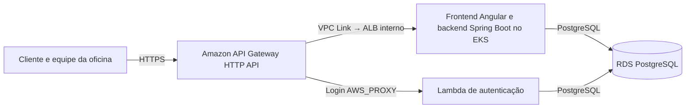
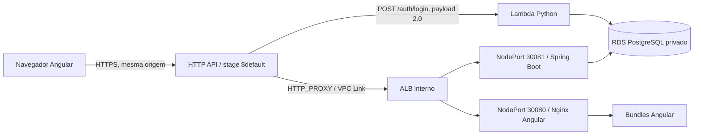
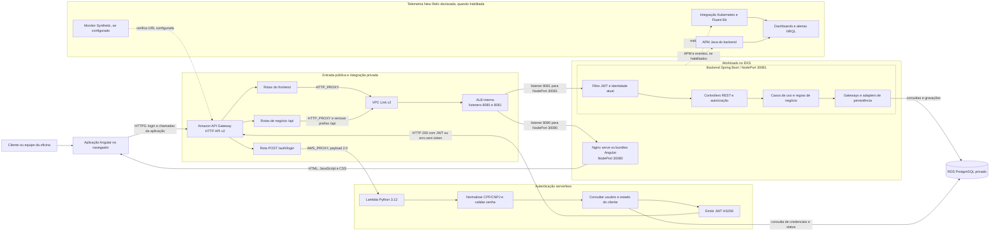
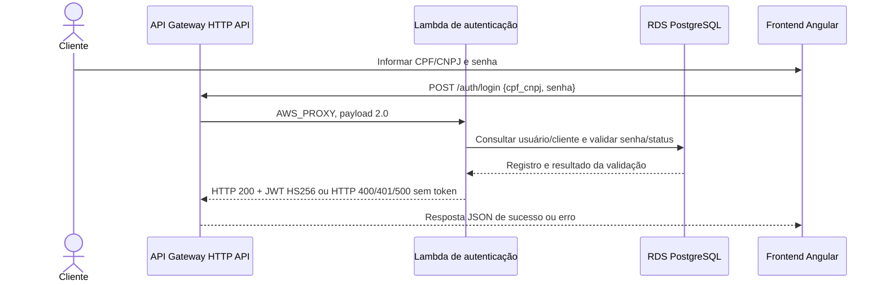
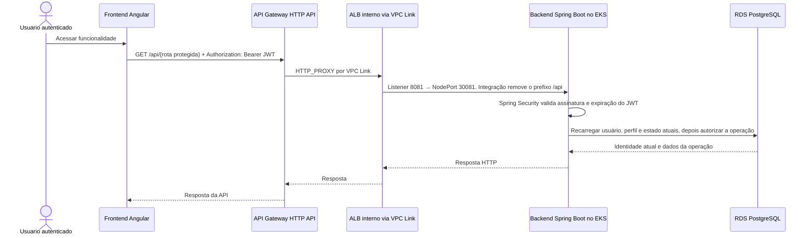
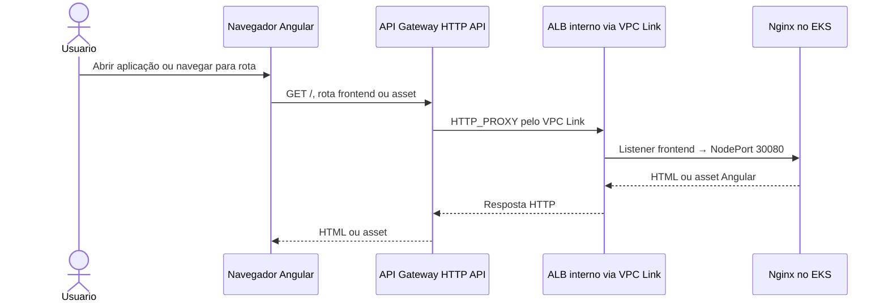
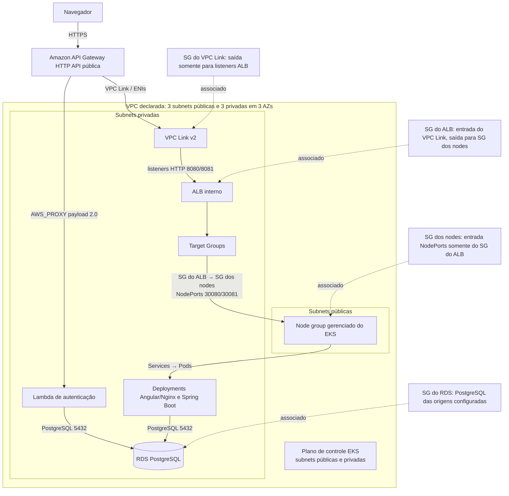

# Arquitetura final: AutoFlow com Amazon API Gateway

Esta página descreve a arquitetura gerenciada pelos roots Terraform e os fluxos implementados nos quatro repositórios.
As decisões estão em [ADR-001](adr-001-api-gateway.md); os detalhes técnicos, na [RFC](rfc-api-gateway.md).

## Decisão

1. Amazon API Gateway HTTP API v2 é a única entrada pública do AutoFlow.
2. `POST /auth/login` usa integração nativa `AWS_PROXY`, payload `2.0`, para a Lambda existente. A permissão `lambda:InvokeFunction` é restrita à conta e à rota.
3. Rotas de negócio e frontend usam integração `HTTP_PROXY` pelo VPC Link v2 para listeners de um ALB interno.
4. O ALB encaminha aos NodePorts `30081` (Spring Boot) e `30080` (Nginx/Angular), que seguem para Services e Pods do EKS.
5. Lambda e backend acessam o RDS PostgreSQL privado. O JWT HS256 emitido pela Lambda é validado pelo backend; perfis e estado do cliente são verificados no domínio. A HTTP API não declara JWT authorizer.

## C4 — contexto

## C4 — contêineres

## C4 — componentes

O contrato da Lambda usa `cpf_cnpj` e `senha`. O diagrama não implica que o API Gateway valide JWT: a validação e autorização das rotas protegidas são feitas pelo backend Spring Boot. O APM Java é configurado na aplicação; o root `infra/newrelic` gerencia a integração Kubernetes, dashboards, alertas e Synthetic conforme as Variables do Environment. A ordem de provisionamento está no [runbook](../eks-primeiro-provisionamento.md).

## Sequências de comunicação

### 1. Login CPF/CNPJ e emissão de JWT

### 2. Acesso autenticado ao backend

### 3. Acesso ao frontend Angular

As respostas negativas de login não geram JWT. Um JWT válido não substitui as verificações de perfil e estado do cliente no backend.

## C4 — implantação e rede

Terraform declara três subnets públicas e três privadas distribuídas em três AZs. O plano de controle do EKS usa subnets dos dois tipos, mas o recurso `aws_eks_node_group` seleciona as subnets públicas. O VPC Link, ALB interno, Lambda e RDS usam subnets privadas. Embora os nodes estejam em subnets públicas, o SG dos nodes aceita as portas 30080/30081 somente do SG do ALB; não há exposição direta dos NodePorts declarada. O SG do ALB permite o SG do VPC Link nos listeners 8080/8081 e saída ao SG dos nodes; o SG do RDS permite PostgreSQL às origens configuradas no root do banco. O tráfego privado VPC Link–ALB usa HTTP; TLS termina no endpoint gerenciado do API Gateway. O [runbook](runbook.md) descreve os passos de provisionamento e validação.

## Rotas e autorização

A matriz executável está em [`routes.tf`](../../infra/api-gateway/routes.tf): 56 rotas de backend, 22 de frontend e uma rota de login. Não há rota catch-all. Rotas de negócio exigem JWT e autorização do Spring; endpoints públicos são somente os declarados no contrato. O API Gateway não substitui a autenticação de domínio.

O frontend chama `/auth/login` e as rotas de negócio no mesmo host. `cors_origins` e `gateway_cors_origins` permanecem allowlists exatas HTTPS para eventuais origens externas; não se usa wildcard.

## States e ownership

| Root proprietário | Responsabilidade final | Variable da State Key no repositório proprietário | Isolamento observado |
|---|---|---|---|
| VPC/EKS (`autoflow-infra/infra`) | VPC, EKS e node group | `AWS_TF_STATE_KEY_INFRA` | O workflow deste repositório exige o prefixo do Environment selecionado. |
| Aplicação (`autoflow/infra`) | Deployments, Services, NodePorts e ConfigMaps | `AWS_TF_STATE_KEY` | O workflow da aplicação consome a Variable; a validação da matriz entre seis roots tem um comando local próprio. |
| RDS (`autoflow-db/infra`) | RDS PostgreSQL e rede do banco | `AWS_TF_STATE_KEY` | O workflow de RDS consome a Variable; a validação da matriz entre seis roots tem um comando local próprio. |
| Lambda (`autoflow-lambda/infra`) | Função Lambda e configuração de execução; a API Gateway HTTP API integra a rota de login | `AWS_TF_STATE_KEY` | O workflow lê a key do Environment selecionado, exige o prefixo do ambiente e valida a separação em relação às keys de VPC/EKS e RDS. O sufixo é externo. |
| API Gateway (`autoflow-infra/infra/api-gateway`) | HTTP API, rotas, integração nativa Lambda, VPC Link, ALB, Target Groups e observabilidade | `AWS_TF_STATE_KEY_GATEWAY` | O workflow deste repositório exige o prefixo do Environment e distingue a key de VPC/EKS e New Relic. |
| New Relic (`autoflow-infra/infra/newrelic`) | Release Helm, dashboards, alertas e Synthetic | `AWS_TF_STATE_KEY_NEWRELIC` | O workflow deste repositório exige o prefixo do Environment e distingue a key de VPC/EKS. |

Para cada Environment, a matriz contém seis keys diferentes, prefixadas por `homolog/` ou `production/`, com sufixos fornecidos externamente. Os consumidores recebem a key exata do root produtor. `terraform_state_contract.py` valida a matriz JSON externa sem acessar AWS; consulte o [runbook de primeiro provisionamento](../eks-primeiro-provisionamento.md) para o procedimento e os valores fornecidos pelos GitHub Environments.

Os states permanecem separados. Nenhum state deve ser editado diretamente ou compartilhado entre contas.

## 4. Provisionamento e operação

O bootstrap do bucket, a validação dos seis States, os gates de Plan/Apply e a ordem de implantação estão descritos no
[runbook do API Gateway](runbook.md), no [runbook de primeiro provisionamento EKS](../eks-primeiro-provisionamento.md)
e no [procedimento de bootstrap S3](../state-bucket-bootstrap.md).
