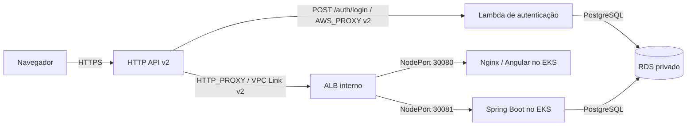

# RFC-001 — Entrada do AutoFlow com Amazon API Gateway HTTP API v2

- **Título:** RFC-001 — Entrada do AutoFlow com Amazon API Gateway HTTP API v2
- **Status:** Implementada.
- **Data:** 13/10/2026.
- **ADR relacionada:** [ADR-001 — API Gateway HTTP API v2](adr-001-api-gateway.md)

## 1. Contexto e Problema

### Síntese executiva

A arquitetura declara API Gateway HTTP API v2 como entrada HTTP pública. O login CPF/CNPJ é encaminhado à Lambda por `AWS_PROXY`; frontend e rotas de negócio seguem por `HTTP_PROXY`, VPC Link v2 e ALB interno até NodePorts no EKS. O banco permanece privado. O backend mantém a validação do JWT e a autorização de domínio. A configuração atual está em Terraform; a situação operacional atual da AWS não é deduzida desta RFC.

### Cenário anterior, problema e motivação

O sistema precisa combinar conteúdo Angular, rotas Spring Boot e autenticação serverless sem tornar diretamente pública a rede de aplicação. Um gateway auto-hospedado adiciona operação de ingress, plugins e ciclo de vida no EKS; expor ALB diretamente reduziria camadas, mas enfraqueceria a separação entre entrada e serviços. Também é necessário limitar quem invoca a Lambda e não transferir a autorização de domínio para uma camada que não consulta o estado atual do usuário.

### Objetivos e não objetivos

**Objetivos:** ponto de entrada HTTPS único; contrato explícito de login; caminho privado via VPC Link/ALB; roteamento explícito de frontend/backend; isolamento por Security Groups; access logs e alarmes declarados; configuração reproduzível por Terraform.

**Não objetivos:** fazer do API Gateway o validador/autorizador de domínio do JWT; provisionar neste root VPC/EKS, RDS ou Lambda; declarar integração `ANY`/catch-all; afirmar implantação de produção ou entrega de alarmes sem configuração de destinos.

### Requisitos e restrições

- Login: `POST /auth/login`, JSON com `cpf_cnpj` e `senha`, integração Lambda `AWS_PROXY`, payload format `2.0`.
- Rotas frontend e backend: integração `HTTP_PROXY` pelo VPC Link; nenhuma rota catch-all; os caminhos são controlados por `infra/api-gateway/routes.tf`.
- CORS por origens HTTPS exatas quando houver cross-origin; throttling geral e limite mais restritivo para login.
- Evitar registrar body, credenciais, JWT, query string e headers em access logs.
- ALB e NodePorts privados; Lambda, banco e workload têm ownership em roots/repositórios separados.
- Conta, região, credenciais e State keys são fornecidos externamente pelos GitHub Environments.

## 2. Proposta / Solução

### Arquitetura e responsabilidades

O diagrama C4, a sequência detalhada de login e as rotas de navegação são mantidos em [arquitetura.md](arquitetura.md); esta RFC os reutiliza para evitar duplicação. O fluxo principal é:

| Componente | Responsabilidade |
|---|---|
| API Gateway HTTP API | Endpoint HTTPS, roteamento explícito, CORS, throttling e access log de metadados. Stage `$default` com `auto_deploy=true`. |
| Lambda | Receber login CPF/CNPJ e senha, autenticar contra RDS e emitir JWT HS256. |
| VPC Link v2 | Conectar integrações HTTP privadas às subnets/SG do ALB interno. |
| ALB interno | Listeners HTTP 8080 (frontend) e 8081 (backend), target groups `instance` e health checks para `/` e `/actuator/health/readiness`. |
| Services de gateway no EKS | NodePorts `30080` (Nginx/Angular) e `30081` (Spring Boot); os pods também têm Services `ClusterIP`. |
| Backend | Validar JWT e expiração, carregar perfil/estado atual e aplicar autorização Spring/domínio. |
| RDS PostgreSQL | Persistência compartilhada para autenticação Lambda e aplicação, sem endpoint público declarado. |

### Contratos e execução

1. Frontend chama `POST /auth/login` com `{ "cpf_cnpj": "…", "senha": "…" }`; a API invoca a Lambda no formato proxy 2.0. A permissão `lambda:InvokeFunction` restringe principal API Gateway, conta esperada e ARN da rota do stage `$default`.
2. Lambda valida credenciais/estado aplicável no banco e retorna token JWT HS256. O segredo deve corresponder ao do backend, mas não é incluído nos documentos ou logs.
3. O frontend envia Bearer JWT pelas rotas de negócio. O Gateway encaminha a rota cadastrada por `HTTP_PROXY` e VPC Link ao listener backend. A aplicação valida o token e consulta o usuário/perfil/estado; o Gateway não é authorizer JWT.
4. Assets e rotas do Angular seguem ao listener frontend/NodePort 30080. A tabela de rotas é declarativa em `routes.tf`; não existe rota `$default`, `ANY` ou proxy catch-all para API.

As integrações HTTP usam payload format `1.0`, timeout declarado de até 29 s e reescrita de path para preservar o contrato `/api` de backend. O login Lambda tem timeout de integração de 20 s. CORS usa allowlist; o default sem origens adicionais atende o padrão same-origin.

### Rede, segurança e observabilidade

O ALB é `internal=true`. O SG do VPC Link só sai para listeners 8080/8081 do SG do ALB; o ALB sai para SG dos nodes nas portas 30080/30081; os nodes aceitam essas portas somente do SG do ALB. Os listeners e target groups usam HTTP dentro da VPC. TLS termina no endpoint público gerenciado do API Gateway; o tráfego interno não é descrito como TLS.

O access log do stage grava requestId, template de rota, status, latência e status de integração em CloudWatch com retenção Terraform de sete dias. A rota de login declara throttling de 5 requisições/s e burst 10; o default da API declara 50/s e burst 100. Métricas detalhadas por rota são opcionais. Alarmes CloudWatch declaram 5xx agregado e target groups sem hosts saudáveis. `alarm_actions` tem default vazio e o workflow não configura destino SNS, portanto condição declarada não significa notificação entregue.

### Terraform, States e CI/CD

O root `infra/api-gateway` lê outputs do State VPC/EKS e consulta o cluster, node group e Lambda existentes; cria API, rotas, VPC Link, ALB, target groups, logs e alarmes. Mantém State S3 separado por ambiente, com State key de gateway fornecida pelo Environment e locking S3. A aplicação, VPC/EKS, RDS e Lambda permanecem em roots próprios; a ordem operacional está em [`runbook.md`](runbook.md) e [`eks-primeiro-provisionamento.md`](../eks-primeiro-provisionamento.md).

CI valida formatação, contratos de rota, módulos e Terraform sem Apply. Push pode liberar Plan automático quando habilitado por Repository Variable e quando a CI do mesmo SHA passou. `workflow_dispatch` com `apply=false` faz Plan; Apply exige `apply=true`, gates do Environment e o Plan/artefato vinculado à execução. Bootstrap S3 é job separado e não executa Terraform init, Plan ou Apply. A definição dos gates é versionada; sua configuração administrativa efetiva no GitHub deve ser tratada separadamente.

## 3. Alternativas Consideradas

Comparação retrospectiva. O histórico registra a arquitetura anterior com Kong e a adoção da HTTP API, mas não registra benchmark formal entre as opções.

| Alternativa | Vantagens | Desvantagens | Impacto e motivo para não adotar |
|---|---|---|---|
| HTTP API v2 (adotada) | Borda gerenciada, integração Lambda nativa e caminho privado para ALB via VPC Link; configuração de rotas/CORS/throttling. | Dependência AWS, múltiplas integrações de rede e autorização de domínio mantida pelo backend. | Compatível com a necessidade de entrada unificada sem hospedar outro gateway; sem alegação de comparação de preço medida. |
| API Gateway REST API | Opções adicionais de gestão de API para casos que as exijam. | Mais superfície de configuração/recursos que o contrato versionado necessita e potencial diferença de custo. | Não escolhida porque os recursos declarados da HTTP API atendem ao fluxo; não há comparação formal registrada. |
| Kong Gateway OSS | Customização por plugins e controle da camada de gateway dentro do cluster. | Operar e atualizar a camada no EKS, administrar ingress/plugins e incluir o cluster na disponibilidade da borda pública. | Kong aparece no histórico como arquitetura anterior; a decisão atual move a entrada para serviço AWS gerenciado. Nenhum benchmark de migração foi registrado. |
| ALB público direto | Reduz serviços intermediários e pode encaminhar diretamente a target groups. | Expõe o balanceador e não fornece o contrato Lambda de login; políticas de entrada, throttling e logs seriam distribuídos. | Não mantém a entrada gerenciada unificada nem o isolamento do ALB. |

### Alternativas de validação do JWT

A plataforma de entrada e a localização da validação de JWT são decisões diferentes. A configuração atual não define authorizer na HTTP API: as rotas encaminham Bearer token ao backend, que verifica assinatura/expiração e consulta o usuário, perfil e estado. O detalhe da emissão e do contrato está na [RFC de autenticação serverless](../../../autoflow-lambda/docs/rfc/RFC-001-autenticacao-serverless-jwt.md).

| Opção | Mecanismo | Trade-off no contrato atual |
|---|---|---|
| Validação no backend (atual) | Spring Security valida o JWT na integração privada e aplica a autorização após recarregar o estado atual do usuário. | Evita nova invocação de authorizer e mantém um único ponto de autorização de domínio; token inválido ainda chega ao backend privado e consome seu processamento. |
| JWT Authorizer nativo da HTTP API | Valida assinatura/claims com issuer e JWKS configurados antes de encaminhar a rota. | O token existente usa HS256 e não declara `iss`/`aud`; adoção demanda mudança compatível do token. Não consulta o banco e não substitui a autorização do backend. |
| Lambda Authorizer `REQUEST` | Executa lógica customizada, podendo verificar HS256 com acesso controlado ao segredo. | Adiciona código, permissão, invocação/cache e gestão de segredo; duplica a validação criptográfica e não decide o perfil/status atual. Não está declarado no root vigente. |

Não há benchmark de latência/custo para essas opções. Nenhuma alternativa de authorizer deve ser considerada implementada por existir uma Lambda de login.

## 4. Impactos e Riscos

**Sistemas afetados:** frontend/URLs same-origin, Lambda, API Gateway, VPC/EKS, SGs, ALB, target groups, Services/NodePorts, RDS e workflows Terraform.

**Contratos e APIs:** a rota de login usa nomes `cpf_cnpj`/`senha`; o backend mantém suas rotas sob o prefixo externo `/api`. Alterar route/path rewrite ou NodePorts sem atualizar root consumidor pode quebrar navegação ou API. Autorização permanece no backend, e os endpoints públicos/de orçamento seguem as regras da aplicação.

**Segurança e privacidade:** minimização do access log; CORS por allowlist; permissão Lambda delimitada; endpoints internos protegidos por SG; JWT compartilhado entre Lambda e backend continua responsabilidade de secret management. Dados em logs CloudWatch têm retenção declarada de sete dias; não foi observada configuração de notificação para alarmes.

**Performance/disponibilidade:** percurso acrescenta API Gateway, VPC Link e ALB; integrações têm timeout máximo declarado de 29s, com 20s para login. Disponibilidade depende de EKS, target health, banco e permissões. Não há SLO ou benchmark de latência registrado.

**Custos/manutenção:** API Gateway, VPC Link, ALB, CloudWatch e tráfego geram custo dependente de uso/ambiente. Rotas enumeradas, target groups, SGs, States e ordem de deploy aumentam manutenção. A dependência AWS reduz portabilidade direta.

| Risco | Mitigação / acompanhamento |
|---|---|
| Nó/Service público ou porta interna exposta | Confirmar `internal=true` e regras SG no Plan; NodePorts aceitam apenas SG do ALB. |
| Requisição de negócio roteada à Lambda errada ou catch-all permissivo | Validar catálogo explícito e teste `scripts/test_gateway_routes.py`; login restrito a uma rota e ARN. |
| JWT aceito sem verificar perfil/status atual | Spring Security e serviços de domínio recarregam perfil/estado; não habilitar autorização baseada apenas em claim. |
| Logs revelarem credenciais ou dados pessoais | Manter access log restrito a metadados da rota; nunca registrar body, query, Authorization ou JWT. |
| Target sem hosts saudáveis ou alarme sem destino | Monitorar health check e CloudWatch; configurar `alarm_actions`/destinos separadamente se notificação for requisito. |
| Drift/Apply em State ou conta errada | State por root/ambiente, validação de conta e Plan revisado/vinculado; parar diante de ownership ou dependência inconclusiva. |

## 5. Plano de Implementação / Rollout

### Pré-requisitos e dependências

1. Configurar Environments, identidade AWS, bucket S3, seis State keys distintas e proteções administrativas; não incluir valores de conta/segredos nos documentos.
2. Executar bootstrap S3 isolado apenas quando o bucket estiver ausente; esse job não cria infraestrutura do gateway.
3. Provisionar VPC/EKS e node group; provisionar RDS e Lambda conforme roots próprios.
4. Gerar Plan de `infra/api-gateway`, confirmar outputs de EKS e Lambda, revisar rotas, ALB interno, SGs, permissões, alarms/logs e State key; aplicar apenas pelo gate autorizado.
5. Provisionar os workloads/Services NodePort da aplicação e confirmar health checks dos target groups.
6. Executar verificações de frontend, login, rota protegida e caminhos de erro com dados sintéticos autorizados, sem registrar tokens.

A ordem de provisionamento é controlada por operadores/runbooks; pipelines independentes não garantem encadeamento. CI/Plan não são Apply nem evidência de recursos criados. Não há feature flag de aplicação requerida pelo desenho atual.

### Recuperação e rollback

Após reset do Learner Lab, confirmar conta/região, bucket/owner e States antes de qualquer init; reconstruir dependências na sequência do runbook. Não inicializar State vazio sobre recursos remanescentes e não executar `destroy` global. Para corrigir rollout, alterar configuração declarativa, gerar Plan atual e aprovar Apply. A reversão para Kong não é automática e exigiria reimplantar explicitamente gateway, rede e configuração de tráfego.

## 6. Critérios de Aceite e Métricas

| ID | Requisito | Método / resultado esperado | Evidência versionada | Situação |
|---|---|---|---|---|
| CA-01 | Catálogo de rotas sem catch-all e compatível com controllers | `python -m unittest discover -s scripts -p 'test_gateway_routes.py' -v`; métodos/paths explícitos, login isolado | `infra/api-gateway/routes.tf`, `scripts/test_gateway_routes.py` | Parcialmente validado — verificável no código/testes; execução nesta revisão não realizada |
| CA-02 | Terraform formatado e válido sem backend remoto em CI | `terraform fmt -check`, `init -backend=false`, `validate` e testes do root sem erro | `.github/workflows/api-gateway.yml` | Pendente — não executado nesta revisão |
| CA-03 | Integração privada protegida | Inspecionar Plan/outputs e confirmar ALB interno, SG VPC Link→ALB→nodes e NodePorts; resultado esperado é sem entrada pública direta ao ALB | `modules/private-eks/main.tf` e `infra/api-gateway/main.tf` | Parcialmente validado — configuração versionada inspecionada; AWS não consultada |
| CA-04 | Login e fluxo protegido preservam contrato e autorização | Smoke com fixture sintética: resposta de login sem registrar token, JWT válido e inválido na rota protegida; backend carrega perfil/status | `arquitetura.md`, workflow/runbook de smoke e código backend | Não verificável — execução atual do runtime não consultada |
| CA-05 | Logs/alarms não expõem payload e notificações são reais apenas com destino | Revisar access log; validar campos requestId/route/status/latency/integrationStatus; testar destinos se configurados | `main.tf`, `variables.tf` | Parcialmente validado — formato declarado; configuração AWS/SNS não verificada |
| CA-06 | State e Apply são separados e protegidos | Confirmar key distinta por ambiente, artifact do Plan no mesmo run/SHA e Apply somente por dispatch/gate | workflow `api-gateway.yml`, `state-bucket-bootstrap.md` | Parcialmente validado — workflow versionado; settings/execução GitHub não verificados |
| CA-07 | Recuperação de falha/reset mantém ownership e serviços | Seguir bootstrap/runbook, inspecionar State e novo Plan; sem destroy/State vazio inesperado | `runbook.md`, `state-bucket-bootstrap.md` | Não verificável — procedimento AWS não executado nesta revisão |

Os valores de throttling, timeout, retenção e alarmes descritos são parâmetros Terraform, não SLOs medidos. Latência, taxa de erro, disponibilidade e custo devem ser observados no ambiente antes de definir objetivos numéricos.

## Referências

- [ADR-001 — API Gateway HTTP API v2](adr-001-api-gateway.md)
- [Arquitetura e diagramas C4/sequência](arquitetura.md)
- [Runbook do API Gateway](runbook.md)
- [Provisionamento EKS e ordem de roots](../eks-primeiro-provisionamento.md)
- [Bootstrap isolado do bucket](../state-bucket-bootstrap.md)
- [Terraform API Gateway](../../infra/api-gateway/main.tf), [rotas](../../infra/api-gateway/routes.tf), [módulo privado](../../infra/api-gateway/modules/private-eks/main.tf)
- [Validação de rotas](../../scripts/test_gateway_routes.py)
- [CI/CD do API Gateway](../../.github/workflows/api-gateway.yml)
