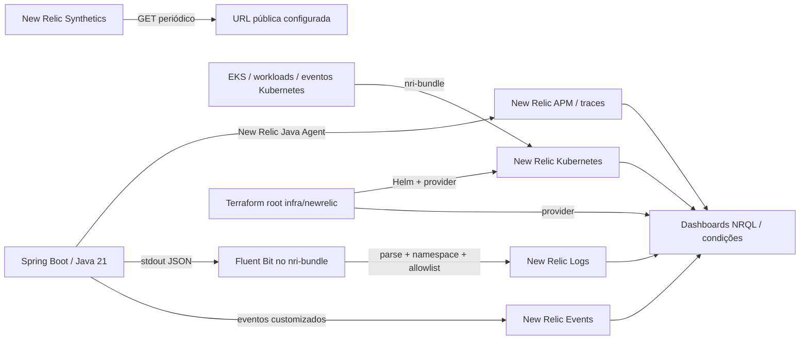

# RFC-002 — New Relic como plataforma de observabilidade do AutoFlow

- **Título:** RFC-002 — New Relic como plataforma de observabilidade do AutoFlow
- **Status:** Implementada na configuração versionada.
- **Data:** 02/11/2026.
- **ADR relacionada:** [ADR-002 — Adoção do New Relic](adr-002-new-relic-observabilidade.md)

## 1. Contexto e Problema

### Síntese executiva

O AutoFlow declara New Relic para APM Java do backend, métricas/eventos Kubernetes, logs JSON coletados por Fluent Bit, Synthetic público, dashboards NRQL, alert conditions e eventos de negócio. Terraform e workflows definem como essa telemetria pode ser configurada, mas não comprovam Apply, ingestão corrente, alertas entregues ou validação ponta a ponta com logs reais.

### Cenário, problema e motivação

O sistema combina API Gateway, Lambda de autenticação, backend Spring Boot no EKS, RDS PostgreSQL e integrações como e-mail. Ordens de serviço atravessam diagnóstico, execução e entrega; falhas podem ocorrer em qualquer estágio. Diagnóstico exige correlacionar latência/transações, disponibilidade e estado dos workloads, logs estruturados e eventos funcionais, com cuidado para não exportar CPF/CNPJ, JWT, `Authorization`, senhas ou conteúdo de requisição.

Sem uma coleta centralizada, cada componente e serviço AWS oferece visibilidade separada. A implementação existente cobre diretamente o backend Java e Kubernetes/EKS; API Gateway possui logs/alarmes CloudWatch próprios e a Lambda não tem instrumentação New Relic declarada nestes roots. Logo, a arquitetura não implica cobertura uniforme de todos os componentes.

### Objetivos e não objetivos

**Objetivos:** documentar coleta APM Java, telemetria Kubernetes, logs JSON via Fluent Bit, eventos customizados, Synthetic, dashboards, alert conditions, controles de segredo e validações objetivas; distinguir configuração declarada de dados efetivamente ingeridos.

**Não objetivos:** afirmar implantação de recursos na conta, cobertura de APM da Lambda/API Gateway, validação ponta a ponta com dados reais, notificação a pessoas/equipes, SLO definido ou custos/retention conhecidos; duplicar instruções completas de Terraform e runbooks existentes.

### Requisitos e restrições

- Instrumentar Spring Boot sem permitir que falha de telemetria altere o resultado funcional.
- Coletar somente namespace configurado; usar `lowDataMode`, parse JSON e allowlist explícita no Fluent Bit.
- Desabilitar encaminhamento duplicado de logs pelo agente APM Java.
- Não enviar dados pessoais, credenciais, tokens, headers ou conteúdo da requisição nos eventos/atributos.
- Separar License Key de ingestão da User API key do provider Terraform; segredos vêm de GitHub Environments, Secrets Manager e Kubernetes Secret.
- Recursos New Relic são opcionais por ambiente; defaults das flags Terraform são `false`.
- Valores de ingestão, retenção e custo dependem da conta/plano SaaS e não são definidos por estes arquivos Terraform.

## 2. Proposta / Solução

### Visão da arquitetura

O fluxo resume recursos versionados, não estado corrente de ingestão. A implantação do chart ocorre somente quando habilitada em um Environment e por Apply autorizado.

### Instrumentação APM Java

O Dockerfile do backend baixa New Relic Java Agent `9.5.0`, confere SHA-256 e o copia como `/opt/newrelic/newrelic.jar`; o `docker-entrypoint.sh` inicia Java com `-javaagent` quando `NEW_RELIC_LICENSE_KEY` existe. Se `NEW_RELIC_REQUIRED=true` sem a licença, o container encerra; execuções locais/teste podem iniciar sem agente quando não obrigatório.

O Deployment configura app name `autoflow-backend`, distributed tracing, logging habilitado, decoração local habilitada e forwarding do agente desabilitado. `backend/newrelic.yml` registra SQL obfuscado e exclui request parameters/headers, URI/URL, statement de banco e mensagens de erro/exceção. O ConfigMap deriva ambiente e label `environment:<ambiente>` do GitHub Environment. O APM fornece transações e duração; traces/correlação dependem do agente e não são garantidos apenas pelas declarações de configuração.

### Kubernetes e Fluent Bit

O root `infra/newrelic` usa chart `nri-bundle` `8.0.32` por Helm, namespace configurável (default `default`), cluster consultado via data source e Secret Kubernetes existente `newrelic-license`, chave `licenseKey`. `values.yaml` mantém `lowDataMode`, `newrelic-infrastructure`, `nri-kube-events`, `newrelic-logging` e `kube-state-metrics` habilitados; componentes opcionais Prometheus, eBPF, Pixie e outros estão desabilitados.

Quando instalado, a integração coleta métricas de infraestrutura/Kubernetes, estados de workload, eventos Kubernetes e métricas de containers (usadas pelos dashboards para CPU/memória). A execução depende do cluster EKS, node groups, acesso do runner, workloads prontos e Secret válido. Não há prova de que o release esteja instalado ou enviando amostras.

O Fluent Bit é o único encaminhador de logs. A configuração `lowDataModeFilters` habilita `Merge_Log` e `Merge_Log_Trim` antes da allowlist, desativa labels e annotations, enriquece metadados do Kubernetes e o filtro final restringe o namespace. Os campos allowlisted são:

`container_name`, `namespace_name`, `pod_name`, `stream`, `log`, `timestamp`, `level`, `logger`, `message`, `service.name`, `deployment.environment`, `request.id`, `trace.id`, `span.id` e `exception.type`. O filtro adiciona `cluster_name` antes de `Allowlist_key`, mas esse atributo não consta na allowlist explícita; sua preservação no evento final não deve ser presumida. Campos arbitrários e metadados labels/annotations não são coletados pelo filtro descrito. A allowlist não substitui sanitização da aplicação: `message` deve continuar sem conteúdo sensível.

### Logs JSON e correlação

`logback-spring.xml` grava JSON em stdout com `timestamp`, `level`, `logger`, `message`, `exception.type`, `service.name` e `deployment.environment`; a codificação inclui somente MDC `request.id`, `trace.id` e `span.id`. `SafeThrowableConverter` reduz exceções ao nome/classe, sem stack trace ou mensagem potencialmente sensível.

`RequestCorrelationFilter` lê `X-Request-ID` somente se corresponder a `[A-Za-z0-9._-]{1,128}`; caso contrário gera UUID, coloca `request.id` no MDC, devolve o cabeçalho na resposta e remove o valor do MDC ao terminar. `trace.id`/`span.id` não são criados por esse filtro: dependem da decoração APM e podem estar ausentes. A documentação da aplicação registra observação local do sufixo de decoração na versão do agente, não uma ingestão real no New Relic.

Os logs HTTP de conclusão estão desabilitados por default e são configuráveis temporariamente apenas em homologação; mesmo habilitados, o filtro registra somente `GET /clientes/me`, método, rota fixa, status e duração, sem body, query string, headers ou IP. Logs de aplicação em geral continuam em stdout; a existência do log HTTP seletivo não prova logs no serviço SaaS.

### Eventos customizados de negócio

`NewRelicBusinessTelemetry` usa `recordCustomEvent` de forma best-effort; falha de agente não altera a operação e somente produz aviso genérico. Os atributos implementados são:

| Evento | Atributos efetivamente emitidos |
|---|---|
| `AutoFlowOrderCreated` | `environment`, `service`, `createdAt`. Não inclui ID/número de OS. |
| `AutoFlowOrderStageCompleted` | `environment`, `stage`, `durationSeconds`, `completedAt`. Valores de estágio codificados no fluxo incluem `DIAGNOSTICO`, `EXECUCAO` e `FINALIZACAO`; intervalos incompletos ou invertidos são ignorados. |
| `AutoFlowOrderProcessingFailure` | `environment`, `operation`, `failureType`, `failureCode`; operações são nomes estáveis como `CREATE_ORDER`, `COMPLETE_DIAGNOSIS`, `COMPLETE_EXECUTION`, `DELIVER_ORDER`, `START_DIAGNOSIS`, `START_EXECUTION`; o código é `UNEXPECTED_PROCESSING_ERROR`. Somente operações da allowlist de OS são emitidas. |
| `AutoFlowIntegrationFailure` | `environment`, `integration`, `operation`, `failureType`, `failureCode`; o tipo é o nome simples da classe, sem mensagem da exceção; código `INTEGRATION_FAILURE`. Chamadas existentes incluem integração `email`/operação `SEND_NOTIFICATION` e `database`/`DATABASE_OPERATION`. |

Os eventos não incluem CPF/CNPJ, token, senha, conteúdo de exceção ou identificador de OS. `service` é atributo de `AutoFlowOrderCreated`; não deve ser presumido para os demais eventos.

### Synthetic, alertas, dashboards e NRQL

Com `ENABLE_NEWRELIC_ACCOUNT_RESOURCES=true`, o provider cria dashboard privado e policy/conditions NRQL. O monitor Synthetic é um `SIMPLE`, com SSL verificado, executado a cada cinco minutos, e só é criado quando URL pública e locations são fornecidas em conjunto. A configuração não adiciona credenciais ao monitor.

O dashboard principal declara widgets para: OS criadas por dia; duração média por etapa; percentis APM p50/p95/p99; CPU e memória por pod; falhas de processamento por operação/código; amostras de etapas; taxa de erro APM; falhas de integração; e tabela de logs com `request.id`, `trace.id` e `span.id`. Uma página de métricas API Gateway é opcional e recebe queries NRQL via variável; isso não declara uma integração AWS→New Relic.

As condições de alerta para falhas de processamento e integração consultam contagens maiores que zero, com janela de agregação de 300 s, atraso de 120 s e limiar maior que zero por 300 s. A condição de taxa de erro APM gera warning acima de 5%; a de latência gera warning para p95 acima de 2 s. Ambas usam janela de 300 s, atraso de 120 s e duração do limiar de 300 s. O código não configura volume mínimo de transações: o comentário no Terraform registra que NRQL não expressa esse mínimo no agregado utilizado, portanto baixo volume pode elevar a taxa observada. Disponibilidade, CPU e memória são condições opcionais alimentadas por consultas externas; os limiares opcionais de CPU/memória geram warning acima de 85% por 600 s. O monitor Synthetic executa a cada cinco minutos; sua condição de falha consulta resultados `FAILED`, com janela de 300 s, atraso de 300 s e limiar por 600 s. Essas consultas e limiares são configuração, não SLO observado.

O root não declara Notification Destination, workflow de notificação ou canal. Portanto alert policy/condition pode existir sem entregar incidente a um destino. API Gateway declara seus alarmes no CloudWatch, também com `alarm_actions=[]` por default.

Há diferenças de schema a confirmar antes de tratar consultas APM como operacionais: widgets em `dashboard.tf` filtram atributo `environment`, enquanto conditions em `alerts.tf` filtram `tags.environment`; o agente recebe label `environment:<ambiente>`. O atributo real precisa ser inspecionado no New Relic e normalizado em mudança própria. O título de widget “Disponibilidade do backend (NRQL confirmada em homologação)” é texto no Terraform, não evidência de aplicação ou dados disponíveis nesta revisão.

### Segurança, Secrets e Terraform

- **License Key:** usada para ingestão pelo agente Java e chart. A aplicação a recebe por Secret do AWS Secrets Manager/GitHub protegido e sincroniza para Kubernetes Secret `newrelic-license`, chave `licenseKey`; o Terraform New Relic valida e referencia nome/chave, sem ler o valor. O chart e Deployment precisam usar o mesmo namespace.
- **User API key:** `NEW_RELIC_API_KEY` é credencial separada do provider New Relic e do inventário remoto; chega como Secret do GitHub Environment, não deve ser configurada no container.
- **GitHub Variables:** flags independentes `ENABLE_NEWRELIC_KUBERNETES` e `ENABLE_NEWRELIC_ACCOUNT_RESOURCES` default false, account ID/região, ambiente, Synthetic e queries não secretas. `NEW_RELIC_ACCOUNT_ID` não é necessário para a ingestão do agente.
- **State e Plan:** `infra/newrelic` tem backend S3 próprio por Environment; bucket/key são externos e distintos dos demais roots. O workflow valida conta/região, EKS, ownership, Secret e inventário; Plan é cifrado, ligado ao commit e guardado como artifact curto; Apply depende de dispatch `apply=true` e dos gates do Environment. O Plan não aplica recursos.
- **Minimização:** não registrar CPF/CNPJ, JWT, Authorization, senha, payload ou mensagem privada; evitar consultas NRQL que retornem mensagens sem necessidade; nunca publicar valores de Secrets, State ou Plans.

### Observabilidade e diagnóstico

Para investigar logs, o README do root prescreve validar contagem, `keyset()` e atributos sem consultar mensagens inicialmente. Em seguida confirmar `service.name=autoflow-backend`, ambiente, namespace/pod e disponibilidade dos campos de correlação. Se só existir `Log` sem campos esperados, verificar parsing/nome de atributo e configuração do coletor antes de alterar NRQL ou habilitar outro forwarder.

## 3. Alternativas Consideradas

Análise retrospectiva de tecnologias tecnicamente plausíveis; não há registro de prova de conceito, benchmark, teste comparativo ou decisão formal de rejeição das alternativas abaixo.

| Alternativa | Vantagens | Desvantagens | Impactos e razão para não adotar |
|---|---|---|---|
| New Relic (adotada) | Integra APM Java, Kubernetes, logs, traces, eventos de negócio, dashboards e Synthetic numa experiência de consulta. | SaaS externo, cobrança/limites de ingestão/retenção, agentes/collector e schema NRQL a manter. | É a plataforma presente na configuração atual; não se declara comparação quantitativa de preço/capacidade. |
| AWS CloudWatch | Integração nativa para API Gateway, Lambda e serviços AWS; logs e métricas podem ficar próximos dos recursos. | Para APM Spring, tracing distribuído, Kubernetes, parsing JSON e eventos/visões de negócio, é necessário compor instrumentação e serviços adicionais. | O projeto mantém alarmes API Gateway em CloudWatch, mas New Relic é o destino declarado para os recursos acima; não há teste de paridade formal. |
| Prometheus + Grafana + Loki + tracing (Tempo/Jaeger/OpenTelemetry) | Controle de armazenamento/consulta e possibilidade de componentes open source. | Operar storage, retenção, alta disponibilidade, atualizações, permissões e integração de Lambda/AWS; maior número de componentes. | Não escolhido na implementação declarada; o custo total de operação não foi comparado. |
| Datadog | Plataforma SaaS com APM, logs, métricas e Synthetic. | Novo fornecedor, configuração/agents, modelo de ingestão e consultas, migração e governança adicionais. | Não escolhida; não há avaliação formal de preço/capacidade registrada. |

## 4. Impactos e Riscos

**Componentes afetados:** backend Spring Boot/Docker, EKS, Kubernetes Secret, Fluent Bit, chart `nri-bundle`, Terraform provider New Relic, dashboards e alert conditions; CloudWatch permanece independente para API Gateway.

**Segurança e privacidade:** logs estruturados e eventos ampliam a superfície de dados exportados a SaaS. A allowlist limita campos, mas `message` segue sensível; a aplicação deve sanitizar texto antes da coleta. License Key, User API key, AWS credentials, State e Plans exigem controle de acesso e rotação próprios.

**Performance/disponibilidade:** agent/collector consomem CPU/memória e dependem de rede/credenciais; baixa ingestão ou indisponibilidade SaaS não deve alterar operações do backend, mas reduz diagnóstico. `NewRelicBusinessTelemetry` trata falhas como best-effort. Não há benchmark de overhead medido nesta RFC.

**Escalabilidade e custos:** o volume cresce com logs, eventos, métricas e frequência de Synthetic. `lowDataMode`, filtro de namespace, allowlist e agentes opcionais desabilitados limitam coleta declarada. Limites/retention e custos reais dependem do plano New Relic e não são controlados no root Terraform.

**Compatibilidade/manutenção:** updates do agente/chart, parser JSON, atributos APM e NRQL podem desalinhar dashboards/alerts. As diferenças entre `environment` e `tags.environment` precisam ser resolvidas com dados de schema antes de usar os alertas como sinal operacional.

| Risco | Mitigação ou ação operacional |
|---|---|
| CPF/CNPJ, JWT, Authorization, senha ou texto privado chega ao SaaS | Canaries automatizados, `SafeThrowableConverter`, log JSON com MDC allowlisted, filtros Fluent Bit e revisão de mensagens/NRQL. Não presumir que allowlist remove texto sensível dentro de `message`. |
| Forwarding duplicado aumenta volume/custo | `NEW_RELIC_APPLICATION_LOGGING_FORWARDING_ENABLED=false`; Fluent Bit do `nri-bundle` é único encaminhador. |
| License Key/User API key confundidas | Separar Secret de ingestão do Secret de provider; nunca colocar User API key no Pod e não usar License Key no provider. |
| Namespace/Secret/workload incompatíveis impedem coleta | Pipeline exige cluster/node groups ativos, workloads/Services disponíveis e Secret não vazio antes do Helm Apply; validar mesmo namespace e rollout do DaemonSet. |
| Dashboard/alert sem dados ou filtros incorretos | Consultar `keyset()`/atributos reais, revisar nome de ambiente/tag e executar queries com dados após Apply; não confiar no título do widget. |
| Alerta não notifica equipe | Confirmar destination/workflow/channel na conta; eles não são declarados por este root. |
| Log com dados pessoais permanece retido | Aplicar minimização antes de enviar e confirmar retenção/limites na conta SaaS; esses valores não são definidos pelo root. |
| Telemetria indisponível bloqueia funcionalidade | Emissão de eventos é best-effort e não deve alterar outcome; monitorar ingestão separadamente da saúde de negócio. |

A aplicação fornece `request.id`, mas o access log API Gateway usa `requestId` próprio e a configuração não comprova propagação/igualdade entre os identificadores. Correlação entre Gateway, Lambda e backend não deve ser chamada de ponta a ponta sem validar propagação explícita.

## 5. Plano de Implementação / Rollout

### Pré-requisitos e sequência

1. Preparar Environment e credenciais AWS corretos, State key New Relic exclusiva, região/conta New Relic e User API key no Secret; validar que a License Key de ingestão está em Secrets Manager e Kubernetes Secret no namespace dos workloads.
2. Confirmar VPC/EKS/node group e aplicar RDS, Lambda, API Gateway e aplicação conforme a ordem dos roots; o root New Relic depende do EKS ativo, workloads e Services já disponíveis.
3. Habilitar `ENABLE_NEWRELIC_KUBERNETES` e/ou `ENABLE_NEWRELIC_ACCOUNT_RESOURCES` de forma independente e revisar valores/Plan. Flags ausentes permanecem `false`.
4. Rodar CI sem credenciais AWS: testes Python New Relic, `terraform fmt`, `init -backend=false` e `validate`.
5. Para CD, Plan por push só ocorre com opt-in da Repository Variable e CI do mesmo SHA; Apply requer `workflow_dispatch`, `apply=true`, artifact do mesmo commit e gates do Environment. Bootstrap de State bucket é dispatch separado e não aplica Terraform.
6. Aplicar primeiro o chart quando autorizado; observar readiness de Fluent Bit/infrastructure agents e confirmar APM do backend com tag/environment esperado. Depois validar ingestão com NRQL, sem retornar conteúdo de mensagens.
7. Criar/confirmar dashboard, alert conditions e Synthetic somente com inputs necessários; validar condições e destinos de notificação separadamente. Não assumir que recursos opcionais existam quando flags/queries/URL estão vazias.

### Validação pós-rollout

- APM: verificar entidade `autoflow-backend`, transações, duração, erros e traces; comparar `environment`/`tags.environment` antes de confiar nos widgets/alerts.
- Kubernetes: verificar amostras de cluster, nodes, pods/containers e eventos, inclusive namespace/cluster usados nos filtros NRQL.
- Logs: começar por `SELECT count(*) FROM Log`, depois `keyset()` e contagem por `service.name`/`deployment.environment`; inspecionar apenas atributos de correlação sem retornar `message` até a sanitização ser conhecida.
- Synthetic: consultar resultado/status de monitor configurado e garantir que URL/location correspondam ao endpoint desejado.
- Eventos: confirmar os quatro event types e seus atributos com amostras sintéticas; não consultar identificadores pessoais ou de OS.
- Alertas: gerar validação controlada e confirmar incident/notification destination se configurado; a existência de condition não prova entrega.

O README do root descreve queries de troubleshooting para contagem, `keyset()` e correlação. O procedimento pós-Apply ainda deve ser executado no ambiente alvo; não há evidência para declarar ingestão ponta a ponta real.

### Rollback e recuperação

Desabilitar ou remover telemetria deve ocorrer por alteração declarativa e Plan/Apply revisados; flags de Kubernetes e recursos de conta são independentes. Antes de desativar/excluir dashboards, policies, Synthetic ou release Helm, revisar o Plan e o approval de mudança destrutiva. Preservar State e ownership; divergência entre recursos remotos e State deve seguir [`newrelic-state-migration.md`](../newrelic-state-migration.md), não `state rm` improvisado.

Em falha de logs, verificar Secret, namespace, DaemonSet/Fluent Bit, parsing `Merge_Log`, allowlist e erros do output plugin; não habilitar forwarding paralelo do agente APM. Em falha de APM, verificar `NEW_RELIC_REQUIRED`, Secret/License Key, agente da imagem e network e evitar imprimir credenciais. Após reset Learner Lab, seguir bootstrap do bucket e reprovisionamento EKS/workloads antes de aplicar New Relic; preservar os States.

## 6. Critérios de Aceite e Métricas

| ID | Requisito | Método / resultado esperado | Evidência versionada | Situação |
|---|---|---|---|---|
| CA-01 | Backend possui agente Java e configuração de ambiente | Verificar versão 9.5.0/hash no build, `-javaagent`, app name, distributed tracing, flags de logging e ausência de forwarding | `autoflow/backend/Dockerfile`, `docker-entrypoint.sh`, `newrelic.yml`, Deployment | Parcialmente validado — configuração versionada inspecionada; APM ingerido não confirmado |
| CA-02 | APM envia transações/latência/traces do ambiente esperado | Consultar entidade, `Transaction`, traces e atributos `environment`/`tags.environment`; resultado com dados recentes e filtros compatíveis | `backend/newrelic.yml`, `infra/newrelic/alerts.tf`, dashboard | Não verificável — conta/ingestão não consultadas |
| CA-03 | Integração Kubernetes coleta métricas e eventos | Após Apply, confirmar cluster, `K8sContainerSample`, CPU/memória, estado de workloads e eventos no namespace configurado | `infra/newrelic/kubernetes.tf`, `values.yaml` | Não verificável — Helm Apply e samples não confirmados |
| CA-04 | Logs JSON são parseados com allowlist e sem forwarding duplicado | Executar `python -m unittest discover -s scripts -p 'test_newrelic_log_pipeline.py' -v`; verificar Merge_Log antes de allowlist, namespace, labels/annotations off e forwarding APM false | `scripts/test_newrelic_log_pipeline.py`, Terraform e Deployment | Parcialmente validado — critérios e testes versionados; execução/injestão SaaS não confirmada |
| CA-05 | Logs não expõem CPF/CNPJ, JWT, Authorization, senha ou mensagem de exceção | `mvn -Dtest=LogJsonCanaryTest test`; JSON válido e canaries ausentes; revisar queries/logging real sem retornar mensagens sensíveis | `autoflow/backend/.../LogJsonCanaryTest.java`, `SafeThrowableConverter.java` | Parcialmente validado — testes/código versionados; execução nesta revisão não realizada |
| CA-06 | Eventos de negócio têm nomes e atributos reais esperados | Executar `NewRelicBusinessTelemetryTest`; mocks devem receber os quatro event types e atributos definidos, sem identificador de OS ou mensagem privada | `autoflow/backend/.../NewRelicBusinessTelemetry.java` e teste homônimo | Parcialmente validado — teste mockado versionado; envio ao SaaS não confirmado |
| CA-07 | Synthetic mede URL pública na periodicidade declarada | Verificar criação condicionada a URL+locations, período 5 min, SSL verificado; depois consultar resultados recentes do monitor | `infra/newrelic/synthetics.tf`, `providers.tf` | Parcialmente validado — declaração inspecionada; monitor/resultado não confirmado |
| CA-08 | Dashboards e alert conditions executam NRQL compatível | `terraform fmt/validate`, testes `test_newrelic_alert_nrql.py`, consultar NRQL com atributo real e dados recentes | `dashboard.tf`, `alerts.tf`, testes Python | Parcialmente validado — fontes versionadas; Plan/Apply e consultas SaaS não confirmados |
| CA-09 | Alertas chegam ao destino operacional | Confirmar Notification Destination/workflow/channel, disparo controlado e entrega; resultado esperado é incidente/notificação observável | Nenhum destino é declarado por este root | Pendente — destino deve ser confirmado/configurado fora do root |
| CA-10 | Logs e traces correlacionam pelo request/trace/span quando disponíveis | Confirmar `request.id` em Log e `trace.id`/`span.id` onde o agente os adiciona; validar não igualdade presumida com requestId API Gateway | RequestCorrelationFilter, Logback, dashboard | Não verificável — dados reais e propagação entre serviços não confirmados |
| CA-11 | Custo, ingestão e retenção estão dentro dos limites da conta | Revisar ingestão/retention/billing na conta, validar lowDataMode e escopo de namespace | `values.yaml`, filtro em `kubernetes.tf`, configuração SaaS externa | Não verificável — plano/uso/limites da conta não consultados |

Terraform fmt/validate/Plan verifica sintaxe/configuração e mudanças propostas; não comprova Apply nem ingestão. As métricas funcionais/técnicas definidas pelo código são contagem de OS criadas, duração média por etapa, falhas de OS/integração, latência e taxa de erro APM, CPU/memória Kubernetes e disponibilidade Synthetic. Metas de SLO, limiares de custo/ingestão e disponibilidade não foram definidos por esta RFC.

## Referências

- [ADR-002 — Adoção do New Relic](adr-002-new-relic-observabilidade.md)
- [README do root New Relic e validação NRQL/logs](../../infra/newrelic/README.md)
- [Terraform Kubernetes/Fluent Bit](../../infra/newrelic/kubernetes.tf) e [values do `nri-bundle`](../../infra/newrelic/values.yaml)
- [Dashboards](../../infra/newrelic/dashboard.tf), [alertas](../../infra/newrelic/alerts.tf), [Synthetic](../../infra/newrelic/synthetics.tf) e [providers/variables](../../infra/newrelic/providers.tf)
- [Workflow CI/CD New Relic](../../.github/workflows/newrelic.yml)
- [Testes de log pipeline e NRQL](../../scripts/test_newrelic_log_pipeline.py), [`test_newrelic_alert_nrql.py`](../../scripts/test_newrelic_alert_nrql.py)
- [Backend New Relic APM/logging](https://github.com/autoflow-fiap/autoflow/tree/develop/backend)
- [NewRelicBusinessTelemetry](https://github.com/autoflow-fiap/autoflow/blob/develop/backend/src/main/java/com/autoflow/infrastructure/observability/NewRelicBusinessTelemetry.java)
- [Logs JSON, correlação e mascaramento](https://github.com/autoflow-fiap/autoflow/blob/develop/backend/src/main/resources/logback-spring.xml), [New Relic YAML](https://github.com/autoflow-fiap/autoflow/blob/develop/backend/newrelic.yml)
- [Procedimento de State New Relic](../newrelic-state-migration.md)
- [Arquitetura API Gateway/EKS](../api-gateway/arquitetura.md)
